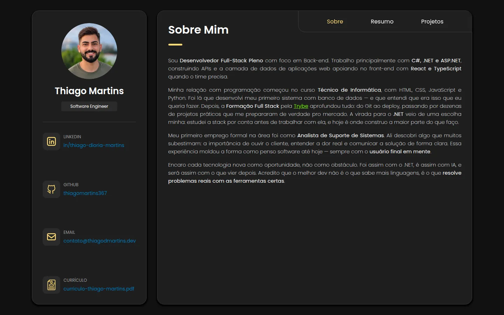
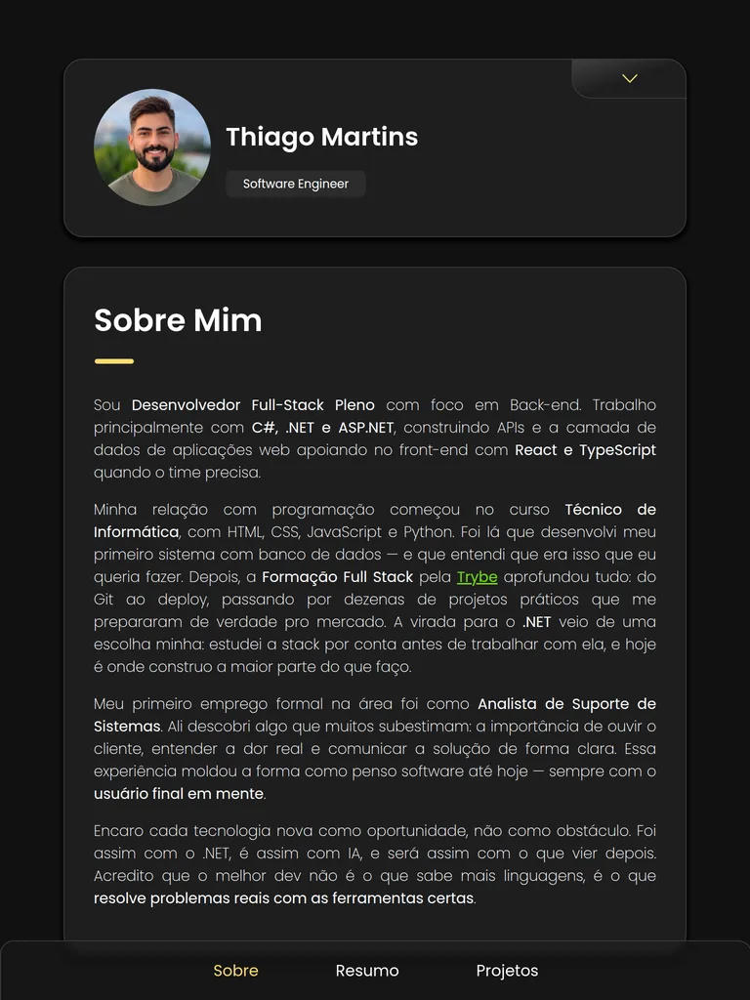
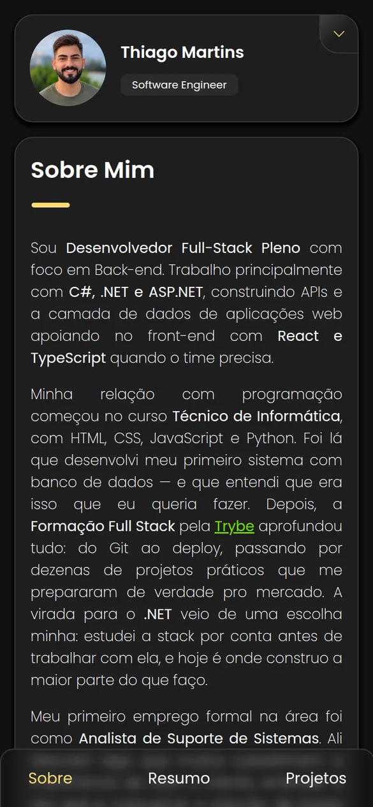
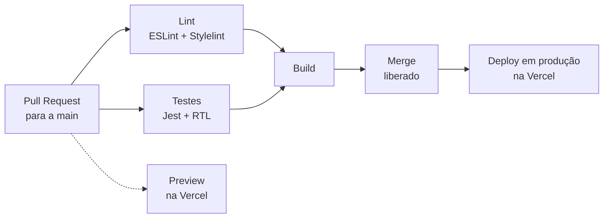

<div align="center">

# Portfólio | Thiago Martins

Portfólio pessoal com experiência, educação, skills, projetos e contatos de **Thiago Martins**, Software Engineer.

[](https://thiagodmartins.dev)
[](https://github.com/thiagomartins367/thiagomartins367.github.io/actions/workflows/index.yml)
[](https://thiagodmartins.dev)
[](LICENSE)

**[:globe_with_meridians: Acessar o site](https://thiagodmartins.dev)**



[Sobre o projeto](#sobre-o-projeto) •
[Funcionalidades](#funcionalidades) •
[Disponibilidade](#disponibilidade) •
[Tecnologias](#tecnologias) •
[Como rodar localmente](#como-rodar-localmente) •
[CI/CD e hospedagem](#cicd-e-hospedagem) •
[Contribuidores](#contribuidores) •
[Contato](#contato) •
[Licença](#licença)

</div>

---

## Sobre o projeto

Uma SPA em **React** sem backend, organizada em três abas:

- **Sobre:** apresentação profissional.
- **Resumo:** experiência, educação e skills.
- **Projetos:** projetos desenvolvidos, com links para os repositórios.

O conteúdo fica separado da interface: experiência, skills, projetos, contatos e o link do currículo ficam em um único arquivo, [`src/database/data.json`](src/database/data.json). Atualizar o portfólio é editar só esse JSON, sem mexer nos componentes.

## Funcionalidades

- **Navegação por abas:** a troca entre Sobre, Resumo e Projetos não recarrega a página e tem transição suave.
- **Contatos e currículo à mão:** LinkedIn, GitHub, e-mail e o download do currículo em PDF ficam no card de perfil.
- **Tela de carregamento:** fica na tela enquanto a fonte e as imagens da primeira tela carregam, para o conteúdo não aparecer pela metade.
- **Destaque animado das skills:** um brilho dourado percorre os cards de skills em loop e pausa enquanto o mouse está sobre eles.
- **Acessibilidade:** atributos `aria-*` nos botões, foco visível na navegação por teclado e animações desativadas com `prefers-reduced-motion`.
- **Desempenho:** imagens em WebP e SVG servidas pelo próprio domínio. As abas ocultas só carregam depois da primeira tela.
- **Atalho no celular:** o site pode ser adicionado à tela inicial, com a foto e o nome como ícone (Web App Manifest).

## Disponibilidade

O layout é responsivo e se adapta a qualquer tamanho de tela:

| Dispositivo | Largura da tela | Layout |
| --- | --- | --- |
| :desktop_computer: **Desktop e notebook** | a partir de 1250px | Perfil e conteúdo lado a lado. A página cabe na tela e só a área de conteúdo rola. |
| :iphone: **Tablet** | de 768px a 1249px | O perfil vira um menu expansível no topo, e a navegação fica fixa no rodapé. |
| :iphone: **Celular** | até 767px | O mesmo layout do tablet, com espaçamentos e cards ajustados para telas menores. |

<p align="center">
  
  &nbsp;&nbsp;
  
</p>

## Tecnologias

| Área | Tecnologias |
| --- | --- |
| **Front-end** |      |
| **Qualidade** |     |
| **Infraestrutura** |      |

## Como rodar localmente

**Pré-requisitos:** [Node.js](https://nodejs.org) 22 ou superior (o CI usa a versão 24) **ou** [Docker](https://www.docker.com) com Docker Compose.

### Com Node.js

```bash
git clone https://github.com/thiagomartins367/thiagomartins367.github.io.git
cd thiagomartins367.github.io
npm ci
cp .env.development.local.example .env.development.local
npm run dev
```

O site abre em **http://localhost:3070**.

### Com Docker

```bash
# Desenvolvimento, com hot reload: http://localhost:3070
cp .env.development.local.example .env.development.local
docker-compose -f docker-compose.dev.yaml up -d

# Produção, com o build servido pelo nginx: http://localhost:3080
cp .env.production.local.example .env.production.local
docker-compose -f docker-compose.prod.yaml up -d
```

<details>
<summary><b>Outros scripts</b></summary>

| Script | O que faz |
| --- | --- |
| `npm run dev` | Servidor de desenvolvimento (porta definida em `.env.development.local`) |
| `npm run build` | Build de produção na pasta `build/` |
| `npm test` | Testes com Jest em modo watch |
| `npm run lint` | ESLint nos arquivos `.js` e `.jsx` |
| `npm run lint:styles` | Stylelint nos arquivos `.css` |
| `npm run compose:up:dev` / `compose:down:dev` | Sobe e derruba o container de desenvolvimento |
| `npm run compose:up:prod` / `compose:down:prod` | Sobe e derruba o container de produção |

</details>

<details>
<summary><b>Estrutura do projeto</b></summary>

```text
├── .github/workflows/index.yml   # Validação dos PRs: lint, testes e build
├── public/
│   ├── assets/                   # Foto, ícones e imagens de projetos e skills
│   └── index.html                # Tela de carregamento e fonte Poppins
├── src/
│   ├── components/               # About, MainCard, Profile, Projects, Resume e SmallCard
│   ├── database/data.json        # Todo o conteúdo exibido no site
│   ├── pages/Home/               # Página única: Profile + MainCard
│   └── loadingScreen.js          # Controle da tela de carregamento
├── Dockerfile.dev                # Imagem de desenvolvimento
├── Dockerfile.prod               # Build multi-stage servido pelo nginx
├── docker-compose.dev.yaml
└── docker-compose.prod.yaml
```

</details>

## CI/CD e hospedagem

Todo código chega à `main` por Pull Request, e a branch é protegida: o merge só é liberado quando o [workflow de validação](.github/workflows/index.yml) passa por completo.



1. **Lint:** ESLint e Stylelint.
2. **Testes:** Jest + React Testing Library, cobrindo a troca de abas, o menu do perfil, o destaque das skills e a tela de carregamento.
3. **Build:** só roda depois que lint e testes passam, e garante que a aplicação compila antes de chegar à `main`.

O deploy é feito pela **Vercel**: cada PR ganha um link de preview, e cada merge na `main` publica a nova versão em produção.

> O deploy já foi feito no **GitHub Pages**, por um job do GitHub Actions que publicava o build na branch `gh-pages` ([versão anterior do workflow](https://github.com/thiagomartins367/thiagomartins367.github.io/blob/c4deffa36c0ba4702692ba3c2244568b84e39f22/.github/workflows/index.yml)). Ele foi substituído pela Vercel, e o GitHub Actions passou a cuidar só da validação dos PRs.

### Hospedagem

| Serviço | Papel |
| --- | --- |
| **Vercel** | Hospeda o site e o entrega pela rede de borda (CDN) da Vercel, com HTTPS e cache em servidores próximos de quem acessa. |
| **Cloudflare** | Gerencia o DNS do domínio `thiagodmartins.dev`, que aponta para a Vercel. |

## Contribuidores

<table>
  <tr>
    <td align="center">
      <a href="https://github.com/thiagomartins367">
        <br>
        <sub><b>Thiago Martins</b></sub>
      </a>
    </td>
  </tr>
</table>

## Contato

[](https://www.linkedin.com/in/thiago-dioria-martins)
[](mailto:contato@thiagodmartins.dev)
[](https://github.com/thiagomartins367)

## Licença

O código-fonte é distribuído sob a licença **MIT**. Veja o arquivo [LICENSE](LICENSE) para mais detalhes.

> A licença vale apenas para o código. A foto, o currículo e as informações pessoais e profissionais exibidas no site (como os textos do `data.json`) pertencem a Thiago Martins e não podem ser reutilizados sem autorização.
